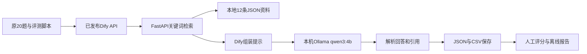

# knowledge-qa-eval Demo 交付与进度

目标：搭通知识问答从资料检索到应用编排、API批量评测、人工评分及报告归档的完整流程。准确率为基线观察值，不作为本轮阻塞项。

## 已完成的三个阶段

| 阶段 | 能力 | 实跑与交付 |
|---|---|---|
| 第一阶段 | FastAPI 关键词检索，12条虚构资料，20道固定题，top_k=3/5 | [检索报告](../reports/report.md)，两组命中14/15，HTTP正常/无匹配/缺参数验证完成 |
| 第二阶段 | Python直接检索并调用本机Ollama，逐题保存、评分与HTML | [Mac实测](../reports/mac-run-02/README.md)，20题完成并评分 |
| 第三阶段 | Docker Dify编排、动态query、对齐提示词/Schema、发布API和20题评测 | [Dify实测](../reports/dify-run-01/README.md)，20题完成并评分 |

正式第三阶段链路：



本轮Dify返回的片段、回答文本和人工判断均与第二阶段20/20逐题相同：检索14/15、回答13/15、正确拒答1/5。第三阶段客户端平均2.81秒，第二阶段2.33秒；不同运行的均值差不能等同于纯Dify编排开销。

## Mac 当前需要的服务

| 服务 | 地址/端口 | 用途 |
|---|---|---|
| Docker Dify / Nginx | http://localhost，API http://localhost/v1 | 界面、已发布工作流和鉴权 |
| 本机 FastAPI | 0.0.0.0:8765 | Dify请求 /retrieval |
| 本机 Ollama | 11434 | Dify凭据 http://host.docker.internal:11434 |
| 诊断转发器 | 11435 | 临时排查工具，正式运行不需要 |

API容器的5001未映射到Mac，评测使用Nginx的80端口，不使用页面中自动拼出的5001地址。只保留一个检索服务。Dify里的Knowledge没有导入资料，本项目通过HTTP接口读取data/corpus.json。

## 下次启动与运行

1. 打开Docker Desktop和Ollama应用。
2. 若Dify容器已停止，在原Dify的docker目录启动。保留你已经配置的.env和单IP放行覆盖文件，不重新覆盖它们：

```bash
cd /Users/echo/Desktop/dify-main/docker
docker compose -p qa-dify -f docker-compose.yaml -f compose.host-access.yaml up -d
```

3. 在项目终端启动一个检索服务并保持运行：

```bash
cd /Users/echo/Desktop/knowledge-qa-eval-main
source qa/bin/activate
python -m uvicorn app:app --host 0.0.0.0 --port 8765
```

4. 需要新一轮时，在另一个终端运行。使用新目录，不覆盖已归档的dify-run-01：

```bash
cd /Users/echo/Desktop/knowledge-qa-eval-main
python3 dify_eval.py run --output-dir reports/dify-run-02
python3 dify_eval.py review --run-dir reports/dify-run-02
python3 dify_eval.py report --run-dir reports/dify-run-02 --open
```

API Key按提示本地隐藏输入，不放到代码、Git、聊天或结果中。已完成的本轮不需要为查看而重跑；离线查看：

```bash
python3 dify_eval.py report --run-dir reports/dify-run-01 --open
```

更新后的report命令只生成HTML，不修改原JSON、CSV或summary。归档目录拒绝review写入，防止把历史评分覆盖。

## 已保存的复现依据

- 固定语料、问题及参考评分标准；Dify导入包和从本地代码生成的构建工具。
- 两阶段真实Mac逐题原始结果、人工评分理由、数据和代码哈希。
- 第三阶段API工作流ID、逐题run ID、请求/响应和客户端及服务端工作流耗时。
- 文件来源与哈希清单，以及从两阶段原始记录计算的comparison.json。
- 工程检查日志。测试桩只验证代码行为，不冒充真实模型结果。

## 已解决的问题

- Docker中Dify通过host.docker.internal访问Mac服务，检索监听0.0.0.0。
- SSRF代理只放行Mac解析出的单IP；Mac地址变化后应重新核对该规则。
- Agent本地沙箱Token通过用户本机.env配置，不随项目发布。
- Dify原手工提示/输出方式与本地不一致，已通过导入对齐工作流修正。
- 实测确认think=false已传递；主要长耗时来自输出量，不能误归因为Dify自身损耗。

## 范围和后续方向

当前是本机可复现Demo：虚构小语料、固定题集、人工评分，不是生产系统。尚未接入真实业务资料，也未完成生产鉴权权限体系、多人并发、持续监控或自动独立语义评审。

如继续推进，应根据用途选择真实资料导入、可视化评测台或自动批量回归；不用再为当前闭环反复优化这20题准确率。
