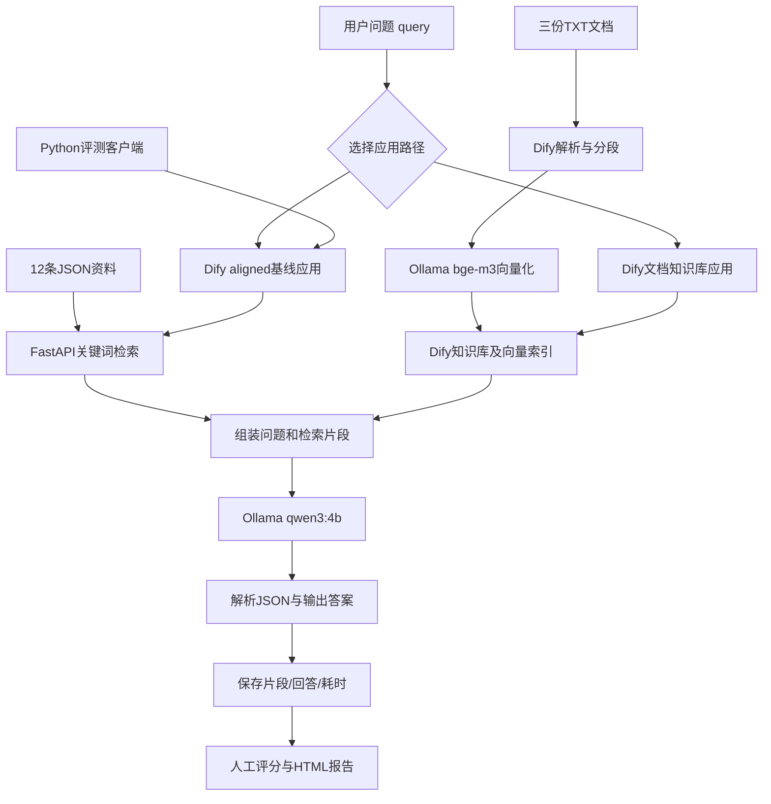

# 项目总览：本地知识问答、评测与文档知识库

## 项目定位

本项目按可验证的小阶段搭建一个中文企业IT服务台场景的知识问答Demo。目标是说明资料如何进入检索、检索如何连接模型、工作流如何发布API，以及如何留下可复核的评测证据。

当前资料全部人工虚构。原始数据集为12条JSON资料、15道有答案题和5道无答案题；新增文档知识库包含账号与认证、网络与VPN、共享文件与恢复三份中文材料。二者是两套数据源，不混用准确率。

## 分层架构

图中评测客户端目前已接通aligned基线API。新文档知识库应用已在Dify中手动单题运行，尚未接入新题集批量评测。

## 每个组件做什么

| 组件 | 职责 | 不负责什么 |
|---|---|---|
| app.py | 从原JSON按人工关键词匹配和排序 | 不生成答案，不读取新增TXT |
| qa_eval.py | 直接调用检索与Ollama，保存和评分 | 不替代人工语义判断 |
| Dify aligned工作流 | 编排原检索、提示、生成和解析，提供API | 不等于Dify自带知识库 |
| dify_eval.py | 调用已发布aligned应用的原20题评测 | 不适配新知识库的KB编号或新题集 |
| Dify Knowledge | 新文档解析、分段、索引及检索 | 本身不生成最终问答 |
| bge-m3 | 将片段/问题转成用于语义检索的向量 | 不是聊天模型 |
| qwen3:4b | 依据片段生成answer和insufficient | 不是检索索引或权限系统 |
| 解析模型JSON节点 | 校验结构并拆出字段 | 不判断回答事实正确与否 |
| ollama_probe.py | 临时记录实际参数和计时 | 正式运行不需要 |

## 四阶段进度

1. **检索接口基线完成。** FastAPI POST /retrieval，正常/无匹配/缺参HTTP验证；同20题分别测top_k=3、5，两组均14/15命中，无答案题3/5仍有片段。
2. **本地问答评测完成。** Mac真实调用qwen3:4b，20题全部完成并人工评分；回答13/15、拒答1/5。单题结果和原始Ollama统计已归档。
3. **Dify API评测完成。** Docker部署，动态query贯穿检索和生成，提示/资料字段/Schema与本地对齐；20题全部通过API执行和评分，逐题片段、答案及判断与第二阶段相同。
4. **文档向量知识库单题链路完成。** 三份TXT入库，bge-m3 Embedding，高质量索引、向量检索；User Input → Knowledge Retrieval → 组装提示 → LLM → 解析模型JSON → Output全部节点成功。尚未形成新题集的批量原始记录和语义评测，也没有归档该新应用的导出包。

## 现有结果与耗时解释

原基线的正式结果：检索14/15、回答13/15、拒答1/5。第二阶段平均客户端耗时2.33秒，第三阶段2.81秒。只说明这两次运行的端到端表现，不是受控负载下的Dify开销测量。

此前长耗时排查发现Dify原手工流程生成1047 tokens，约33秒用于生成；对齐Schema和提示后同题生成48 tokens，热请求约2.19秒。实际参数由临时转发器确认，不再把面板False或推理标签分离等同于关闭思考的证据。

最新文档知识库截图中，Knowledge Retrieval为2.846秒，LLM为34.791秒，显示576 tokens，全部节点成功。截图没有Ollama原始计时或完整答案，不把576当成输出token，也不直接给出变慢原因。此次资料、检索路径和上下文不同，不与旧Q01的48-token结果作直接速度结论。

## 新文档的引用与元数据

组装代码将Dify检索结果转为id/title/content，每次按返回顺序分配KB-1、KB-2等编号。它们是本次请求的引用别名，不是文档永久ID，换一个问题后同编号可能代表不同片段。

未来评测应保存Dify原始document_id、segment_id、文档名称、版本和正文，再建立稳定的证据标签。当前手动组装代码未保留全部原始元数据；现阶段可以核对原文来源，不宣称已经满足企业级引用追踪。

insufficient只是模型对当前资料是否充足的自述，不能直接当作正确拒答。正确性仍需题集及独立判定。

## 运行与更新原则

- 原应用、20题标签和reports/mac-run-02、reports/dify-run-01作为历史基线保留。
- 新资料使用复制出的knowledge-qa-docs应用，只有该应用需要bge-m3。
- 文档知识库应用不调用8765检索服务；旧基线仍需要8765。
- 模型凭据正常直连11434，11435只用于临时诊断。
- 新资料不直接套用dify_eval.py的20题评分，该脚本严格校验旧语料及IT-ID引用。
- 现有环境不必因文档整理重新安装；保存新的导出或评测时使用新目录。

## 交付目录与下一步

- 架构/启动：[Demo交付](demo-handoff.md)
- 新知识库搭建：[文档知识库指南](document-knowledge-base.md)
- 原始批量证据：[第二阶段](../reports/mac-run-02/README.md)、[第三阶段](../reports/dify-run-01/README.md)
- 最新单题证据范围：[知识库验证记录](../reports/knowledge-base-smoke/README.md)

建议的下一步是归档knowledge-qa-docs导出包（不含凭据）、准备新文档对应题集和稳定证据标签，再选择是否接批量API评测或评测台页面。当前不需要为了整理项目重复跑原20题。

企业应用还需补充权限过滤、文档更新/删除同步、有效版本管理、审计和生产可靠性；本Demo目前没有实现这些功能。
